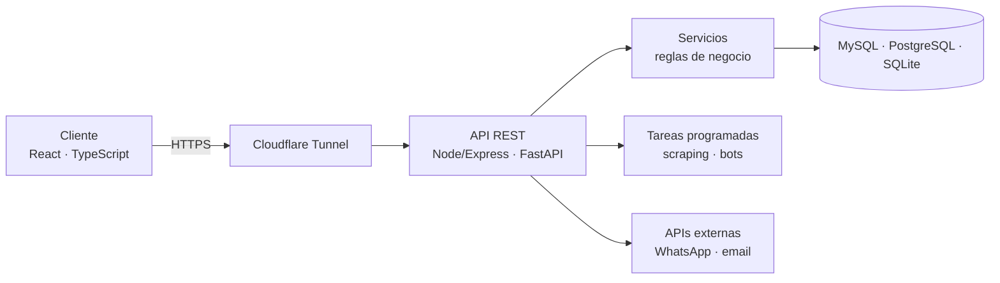

<div align="center">

# Pedro José Bermúdez López

### Desarrollador Backend · Full Stack · Automatización de procesos

📍 Armenia, Quindío, Colombia · 🟢 Disponible de inmediato · Full-Time o remoto

[](https://peterjhosep31.dev)
[](https://www.linkedin.com/in/peterjhosep31)
[](mailto:bermudezlopezpedrojose@gmail.com)

</div>

---

## `whoami`

```ts
const pedro = {
  rol:         "Backend / Full Stack / Automatización",
  experiencia: "~3 años en software empresarial (PHP + MySQL)",
  formacion:   "Tecnólogo en Análisis y Desarrollo de Software · SENA",
  hago:        ["APIs REST seguras", "bots y chatbots", "web scraping", "tareas programadas"],
  meGusta:     "convertir tareas manuales de horas en minutos",
  buscando:    "rol backend, full stack o automatización · Armenia o remoto",
};
```

- 🔧 Rediseñé desde cero el **módulo de inventario** de una aplicación empresarial.
- ⚡ Construí un **bot que redujo una tarea de 3–4 horas a unos 10 minutos**.
- 💬 Desarrollé un **chatbot de WhatsApp** (API de Meta) y la asignación de sesiones a agentes en un sistema de atención tipo PBX.

---

## 🚀 Proyectos

### 📦 [PTR — Gestor de paquetes](https://github.com/peterjhosep31/ptr-package-manager) · *código abierto*
CLI + API REST que resuelve dependencias, automatiza builds y trae un **chatbot integrado** que ayuda con la instalación y las dudas del proyecto. Desplegado con Docker.
`TypeScript` `Node.js` `Express` `Docker`

### 🔐 ConfigManager — Gestor de credenciales *(vault)* · [demo en vivo](https://configmanager.peterjhosep31.dev/)
Guarda y comparte secretos entre servicios y equipos sin exponerlos en texto plano.
- API firmada: **HMAC-SHA256** por petición, **nonce** de un solo uso y respuestas firmadas
- **MFA/TOTP** y **Magic Links**, roles y permisos por sección
- Secretos cifrados en reposo con **AES-256-GCM**
- Expuesto por **Cloudflare Tunnel**, sin abrir puertos

`Node.js` `TypeScript` `Express` `React` `SQLite` `Docker Compose`

### 🐖 Sistema de gestión porcícola · *full stack*
Ciclo reproductivo, engorde, inventario de cuidos con facturación, capital e inversores y **scraping diario** del precio del cerdo en pie.
- ~80 endpoints en 12 routers, arquitectura por capas
- **JWT** con refresh token en cookie HttpOnly, **OTP** por WhatsApp o email, roles y rate limiting
- **104 pruebas automatizadas** (pytest + vitest) y migraciones con Alembic

`Python` `FastAPI` `PostgreSQL` `SQLAlchemy` `React` `TypeScript`

> 🔒 ConfigManager y el sistema porcícola son repositorios privados. Si te interesa ver el código, escríbeme y te doy acceso.

---

## 🧱 Cómo construyo



Capas claras (modelos → schemas → servicios → routers), seguridad desde el diseño (firmas, MFA, cifrado en reposo), pruebas automatizadas y despliegue con Docker.

---

## 🛠️ Tecnologías

**Backend**


**Datos**


**Frontend**


**Herramientas e infraestructura**


---

<div align="center">

**¿Tienes una vacante de backend, full stack o automatización?**
[Escríbeme](mailto:bermudezlopezpedrojose@gmail.com) · [Mira mi portafolio](https://peterjhosep31.dev)

</div>
